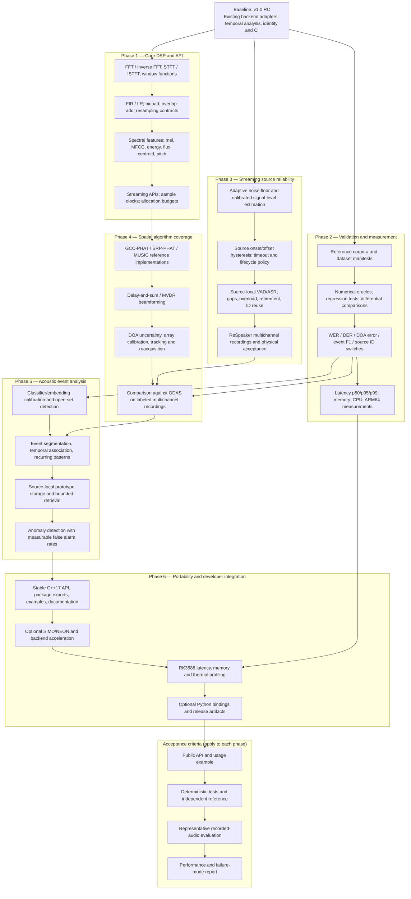

# libaudition — Compact Development Roadmap

This is a condensed companion to the [full technical roadmap](development_roadmap.md), not a replacement.

Status: proposed; not a release commitment. This roadmap is scoped to the reusable acoustic-processing library. ROS 2 integration, navigation, visual/radar fusion and application policy remain outside the library.

## Current baseline

The repository already includes backend adapters for ODAS, sherpa-onnx, WebRTC AEC3, YAMNet, EfficientAT, CLAP, WORLD, AASIST and GTSAM, together with source identity, recording and temporal-event components. Presence of an adapter or passing synthetic tests does not establish real-world accuracy.

## Priorities

1. **P0: DSP primitives.** Publish reusable FFT/STFT, filtering, spectral-feature and streaming contracts rather than leaving these operations embedded inside model-specific frontends.
2. **P0: Recorded-data validation.** Build versioned reference datasets, annotation rules, reproducible benchmark runners and failure-mode reports.
3. **P0: Source lifecycle.** Resolve onset sensitivity and stale-track behavior using recorded microphone-array cases and explicit source expiry policies.
4. **P1: Spatial alternatives.** Add independent DOA and beamforming implementations, with comparisons against ODAS.
5. **P1: Event-level analysis.** Extend source-bound classification, recurring-pattern recognition, open-set detection and anomaly evaluation.
6. **P1/P2: Packaging and performance.** Benchmark x86/ARM64, improve documentation and packaging, and add optional hardware acceleration or language bindings based on measured demand.

## Phase acceptance

Each implementation must include a documented API, bounded-state behavior where streaming is supported, deterministic numerical tests, independently annotated real-audio evaluation when quality is claimed, and resource measurements on relevant targets. A CI pass is not equivalent to a quality benchmark. Missing corpora must be reported as not evaluated, not passed.

## Diagram

The source diagram is [development_roadmap_summary.mmd](development_roadmap_summary.mmd). GitHub Markdown renders the same diagram below.

