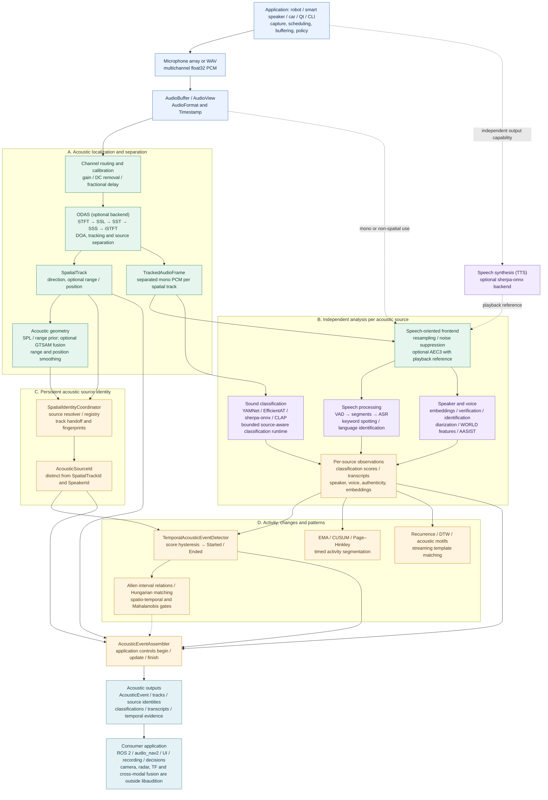

# Functional architecture and algorithm map

> **Scope:** Describes the capabilities present in the libaudition source tree as of 2026-10-23. The diagrams show **possible application-level compositions**, not a mandatory pipeline, fixed scheduler, or runtime performance claim.

libaudition is a C++17 library of backend-independent acoustic data types and composable algorithms. It provides acoustic observations; the consuming application chooses which stages to connect, how to schedule them, and what actions to take.

## 1. Audio signal flow

The first diagram follows the audio from a multichannel capture through optional spatial processing into independent source-local analysis, persistent source identity, temporal reasoning and acoustic-domain outputs.

### Reading the pipeline

1. **Input and DSP:** `AudioBuffer` / `AudioView`, explicit sample format and clocks, channel mapping, gain/DC/fractional-delay calibration and signal quality metrics.
2. **Spatial processing (optional):** ODAS performs acoustic direction-of-arrival estimation, tracking and source separation. Acoustic range/position are separate optional estimates; DOA alone must not imply a metric position.
3. **Per-source processing:** Sound tagging, VAD, ASR, language/keyword detection, speaker recognition, voice analysis and authenticity detection are independent branches. A mono input may bypass ODAS entirely.
4. **Identity:** The `SpatialTrackId` produced by spatial tracking is temporary. A source identity resolver can associate successive tracks with a persistent `AcousticSourceId`. `SpeakerId` is a separate speech identity.
5. **Time and events:** The classifier event detector produces start/end transitions from timestamped scores. Other temporal algorithms analyze changes, recurrence, patterns and interval associations. `AcousticEventAssembler` composes selected evidence under caller-controlled lifecycle rules.
6. **Application boundary:** ROS 2 integration, recording policy, navigation, multi-sensor fusion and robot actions belong to consuming software, not libaudition.

**Important routing rule:** The array-localization branch should use calibrated array channels **before speech-oriented mono enhancement**. Echo cancellation and denoising can change inter-channel phase, so they should not be applied to raw localization input by default. WebRTC AEC3 takes a separate pre-DAC playback reference.

## 2. Algorithm and capability map

The second diagram is a functional inventory grouped by the problem each module solves. It is **not** another executable pipeline.

```mermaid
flowchart TB
  LIB["libaudition: composable C++17 acoustic toolkit"]

  subgraph FOUND["FOUNDATION: audio formats and signal processing"]
    direction LR
    A["PCM / time / geometry<br/>AudioBuffer, AudioView, ClockIdentity<br/>Probability vs Score, covariance"]
    B["DSP / calibration<br/>RMS, peak, clipping, quality<br/>channel routing, mixdown, fractional delay<br/>SPL and sound-level range priors"]
    C["Recording and replay<br/>WAV read / write, recording timeline<br/>per-source WAV recording"]
  end

  subgraph ENGINE["ACOUSTIC PERCEPTION: algorithms and optional backends"]
    direction LR
    D["Spatial perception<br/>ODAS: STFT / SSL / SST / SSS / iSTFT<br/>GTSAM fusion, range prior, smoothing"]
    E["Classification and embeddings<br/>YAMNet, EfficientAT, sherpa tagger<br/>CLAP open-vocabulary labels / audio embeddings<br/>progressive per-source classification"]
    F["Speech, speaker and voice<br/>VAD, offline / streaming ASR, KWS, language ID<br/>speaker embeddings / verification / ID / diarization<br/>WORLD analysis, AASIST authenticity, TTS"]
  end

  subgraph REASON["IDENTITY, MEMORY AND TEMPORAL ANALYSIS"]
    direction LR
    G["Identity and acoustic memory<br/>track ID → AcousticSourceId<br/>source / speaker / prototype registries<br/>cosine similarity prototype matching"]
    H["Changes and event boundaries<br/>EMA, CUSUM, Page–Hinkley<br/>timed activity segmentation / score hysteresis"]
    I["Patterns and association<br/>dynamic time warping, recurrence, motifs<br/>streaming template recognition<br/>Allen intervals / Hungarian / Mahalanobis"]
  end

  subgraph SYS["COMPOSITION, BOUNDED EXECUTION AND EXTENSIBILITY"]
    direction LR
    J["AcousticEventAssembler<br/>explicit begin / update / finish / cancel<br/>source identity and timestamp validation"]
    K["Runtime lifecycle and isolation<br/>bounded queues, cancellation, per-source state<br/>explicit forget / reset / retirement"]
    L["Replaceable algorithms<br/>backend-neutral interfaces / registries<br/>optional CMake adapters, external model weights"]
  end

  HOST["Outside libaudition: device capture and scheduling, ROS 2, camera / radar / TF,<br/>navigation, application policy and cross-modal sensor fusion"]

  LIB --> FOUND
  LIB --> ENGINE
  LIB --> REASON
  LIB --> SYS
  FOUND --> ENGINE
  ENGINE --> REASON
  REASON --> SYS
  SYS -.-> HOST

  classDef h fill:#e9f2fe,stroke:#396da2,color:#153550;
  classDef b fill:#ecf7f0,stroke:#4e8f70,color:#1a4834;
  classDef m fill:#f0edfa,stroke:#8071aa,color:#3b3053;
  classDef r fill:#fff2df,stroke:#c28b37,color:#553917;
  classDef s fill:#e7f3f5,stroke:#4b8390,color:#234550;
  class LIB,HOST h;
  class A,B,C b;
  class D,E,F m;
  class G,H,I r;
  class J,K,L s;
```

### Implementations and interfaces

| Area | Available mechanisms | Representative components / optional adapters |
| --- | --- | --- |
| DSP / capture representation | PCM buffers, layout conversion, resampling, signal quality, gain/DC/fractional-delay calibration, SPL calibration, echo cancellation and denoising interfaces | `AudioFrontend`, `SignalMetrics`, `SamplerateResampler` (optional), WebRTC AEC3 (optional), sherpa denoising (optional) |
| Spatial audio | Acoustic direction, tracking, source separation, range priors, spatial fusion and smoothing | `ISpatialAudioEngine`, ODAS (optional), GTSAM fusion (optional), `TemporalSpatialTrackSmoother` |
| Sound semantics | Sound tagging, audio/text embeddings, open-vocabulary classification, progressively refined and per-source classification | YAMNet, EfficientAT, sherpa-onnx and CLAP (optional); `SourceClassificationRuntime`, `ProgressiveSourceClassificationRuntime` |
| Speech | VAD, speech segments, offline/streaming ASR, keyword spotting, language identification, TTS | sherpa-onnx (optional), `PerSourceSpeechRuntime`, `AsyncSpeechIngressWorker` |
| Speaker / voice / authenticity | Embeddings, verification, identification, diarization, acoustic voice traits/features, spoof detection | sherpa-onnx, WORLD, AASIST (optional) |
| Acoustic identity / memory | Persistent source IDs, registries, matching acoustic prototypes | `SpatialIdentityCoordinator`, `HeuristicSourceIdentityResolver`, `CosineSoundPrototypeMatcher` |
| Temporal inference | EMA, CUSUM, Page–Hinkley, hysteresis, activity segmentation, recurrence, DTW, motifs, source-local pattern matching, interval relations and association | `TemporalAcousticEventDetector`, `RecurrenceAnalyzer`, `DynamicTimeWarping`, `AcousticMotifFinder`, `HungarianEventMatcher`, `MahalanobisGate` |
| Composition / infrastructure | Event lifecycle, bounded work queues, cancellation, per-source generation safety, WAV recording/replay, factory and model registries | `AcousticEventAssembler`, `BoundedQueue`, `FactoryRegistry`, `InMemoryModelRegistry` |

### Architectural guarantees and limitations

- The stable public API exposes C++17 libaudition types, not ODAS, ONNX Runtime, GTSAM or ROS 2 types. Optional engines are replaceable implementations behind narrow interfaces.
- Algorithms do not implicitly create a global capture or scheduling pipeline. Some **explicitly selected runtimes** own bounded background workers; applications still control capture and execution policy.
- Outputs retain their native uncertainty semantics. Classifier scores, cosine similarity and calibrated probabilities are not interchangeable.
- A detected spatial track, a persistent acoustic source and an identified speaker are three different identities.
- Model weights are **not included** by the core library. Availability of a backend does **not** establish model accuracy, real-microphone reliability or device-specific latency.
- Some features are independently callable primitives rather than automatic stages of the illustrated end-to-end path.

## Diagram sources and maintenance

- [Audio signal flow (Mermaid source)](images/libaudition_signal_flow.mmd)
- [Capability map (Mermaid source)](images/libaudition_capability_map.mmd)

The two fenced Mermaid diagrams are rendered directly by GitHub. Keep the `.mmd` sources synchronized when changing these diagrams; no PNG export or externally hosted rendering service is required.

**Related documentation:** [architecture and dependency boundaries](architecture.md), [specification](specification.md), [audio frontend](audio_frontend.md), [ODAS backend](backends/odas.md), [per-source speech](per_source_speech.md), [temporal acoustic events](temporal_acoustic_events.md), [temporal patterns](temporal_patterns.md), [algorithm test matrix](algorithm_test_matrix.md).
