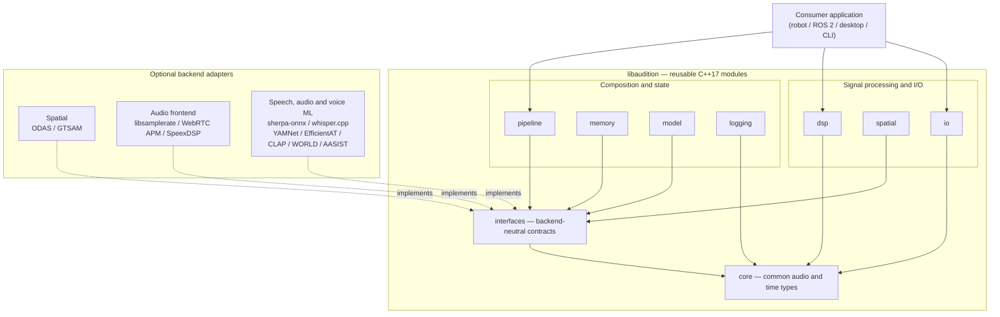

# libaudition

**Composable C++17 acoustic perception toolkit** for spatial audio, source tracking, speech, sound classification, acoustic identity, and temporal event analysis.

The library provides reusable algorithms and acoustic observations. Applications own capture, scheduling, storage, ROS 2 integration, multimodal fusion, and actions. Optional ML backends and model weights are separate from the dependency-light core.

## Modular architecture

libaudition is made of small, composable C++17 modules. The diagram shows **which parts provide the foundations, processing and composition**; it is a module map, **not** a mandatory audio-processing order or a fixed threading model. Applications select only the components they need.

### Main modules

These are the actual CMake-exported building blocks. Their targets have the form `audition::<module>`.

- **[core](specification.md)** — common C++ types, PCM buffers and views, timestamps, clock identities and error handling; the foundation of the SDK.
- **[interfaces](backend_contracts.md)** — abstract contracts for spatial analysis, VAD/ASR, sound classification, speaker analysis and other interchangeable engines.
- **[io](cli_examples.md)** — reusable WAV file I/O and recording-timeline serialization, independent of Qt or audio-device capture.
- **[dsp](audio_frontend.md)** — basic signal processing, channel routing/calibration, level and quality measurements, and audio-front-end utilities.
- **[spatial](functional_architecture.md)** — acoustic geometry, calibrated SPL/range priors and temporal smoothing; separation/localization engines are provided by optional adapters.
- **[pipeline](per_source_speech.md)** — bounded composition/runtime helpers: source-aware classification, per-source speech, temporal events, source tracking/identity handoff and event assembly.
- **[memory](spatial_identity_integration.md)** — registries for acoustic sources, speakers and sound prototypes, with matching and persistent source-identity resolution.
- **[model](models.md)** — a backend-neutral in-memory registry for model metadata; model weights and runtime engines remain separate.
- **[logging](api.rst)** — logging abstractions and integration points without committing applications to a particular logging implementation.

### Optional backends

The adapters implement selected interfaces and are enabled independently at build time. They are **not all installed by default**; ML model weights are also separate.

- **Spatial:** [ODAS](backends/odas.md) estimates source directions, tracks sources and separates audio; [GTSAM](backends/gtsam.md) provides optional acoustic-only geometric fusion.
- **Audio enhancement:** [libsamplerate](audio_frontend.md) performs stateful resampling; [WebRTC APM](audio_frontend.md) offers echo cancellation and gain processing; [SpeexDSP](speech-agc-backends.md) is an optional source-gain processor.
- **Speech and synthesis:** [sherpa-onnx](backends/sherpa.md) supplies VAD, speech recognition, keyword spotting, speaker and TTS capabilities according to the chosen models; [whisper.cpp](ACOUSTIC_SCENE_SPEECH_BACKENDS.md) is an alternative ASR engine.
- **Sound classification and embeddings:** [YAMNet](backends/yamnet.md) tags AudioSet events; [EfficientAT](backends/efficientat.md) provides experimental audio tagging; [CLAP](backends/clap.md) provides semantic audio/text embeddings.
- **Voice characterization:** [WORLD](backends/world.md) extracts acoustic voice features; [AASIST](backends/aasist.md) detects audio spoofing with its optional model.

**Application boundary:** microphone capture, scheduling policy, user interfaces, ROS 2, camera/radar fusion and robot navigation belong to consuming applications, not the libaudition core. For detailed signal-flow and algorithm diagrams, see the [functional architecture](functional_architecture.md).

## Documentation
- [Source code](https://github.com/ARDev1161/libaudition)
- [Current release-candidate status](release_v1_rc1.md)
- [Functional architecture and algorithm map](functional_architecture.md)
- [C++ API reference](api.rst)

~~~{toctree}
:caption: Getting started
:maxdepth: 2

getting_started
cli_examples
full_demo_build
qt_demo
~~~

~~~{toctree}
:caption: Architecture and contracts
:maxdepth: 2

functional_architecture
architecture
specification
backend_contracts
audio_frontend
per_source_speech
temporal_acoustic_events
temporal_patterns
~~~

~~~{toctree}
:caption: Optional backends
:maxdepth: 1

backends/odas
backends/sherpa
backends/yamnet
backends/efficientat
backends/clap
backends/aasist
backends/world
backends/gtsam
~~~

~~~{toctree}
:caption: C++ reference
:maxdepth: 2

api
~~~

~~~{toctree}
:caption: Development and releases
:maxdepth: 1

development
development_roadmap
models
test_maintenance_map
ctest_suites
algorithm_test_matrix
qt_model_validation_matrix
release_v1_rc1
release_v1_acceptance
site_build
~~~

The website is built from the source documentation in this repository. API declarations are generated from public headers in the same commit; check the release notes and backend requirements before assuming an optional model or device has been validated.
